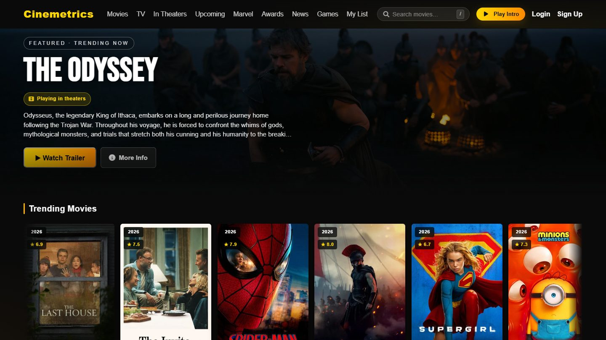
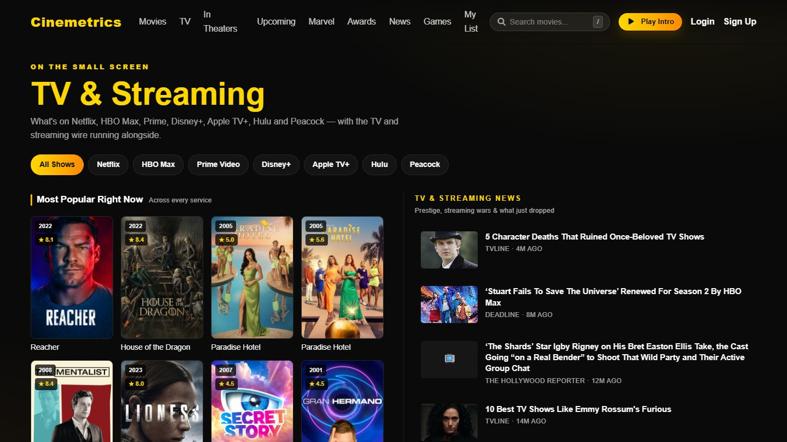
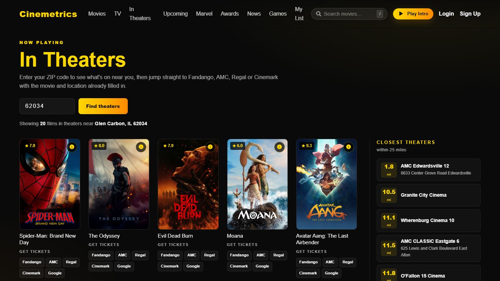
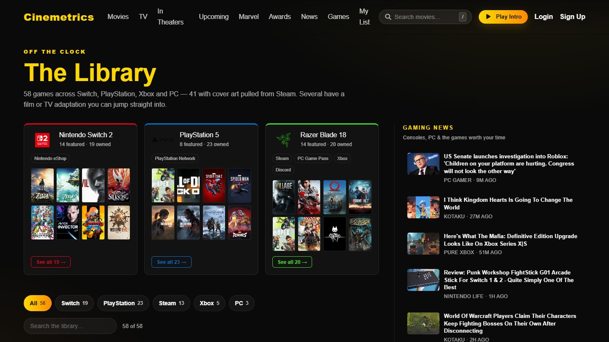
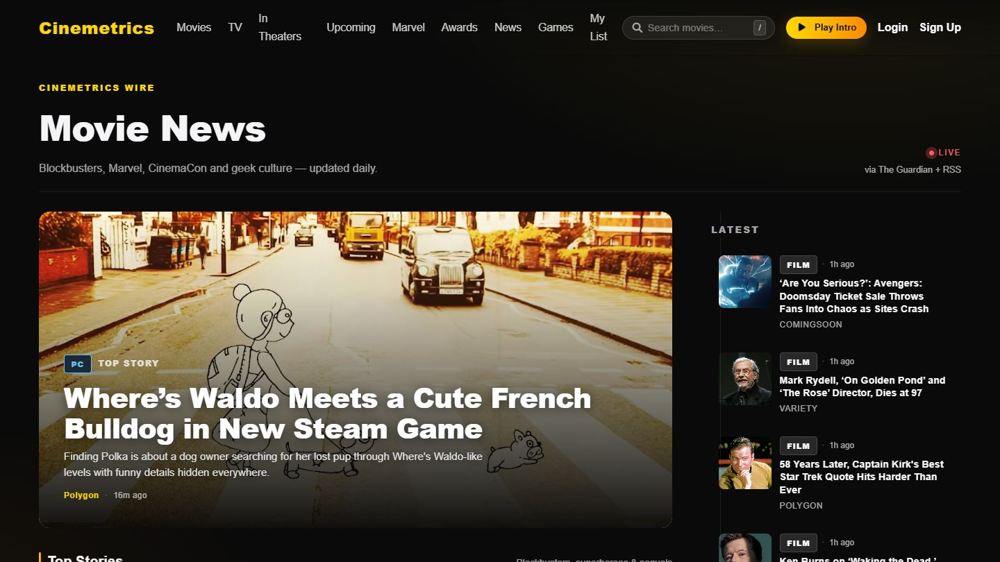
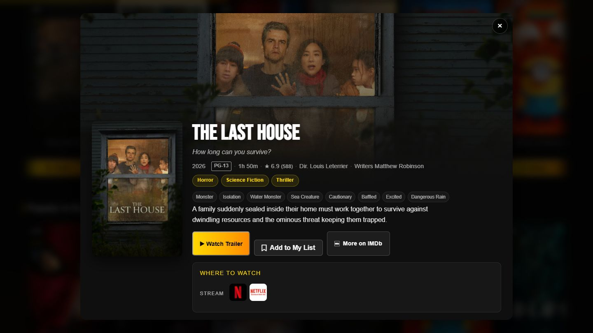
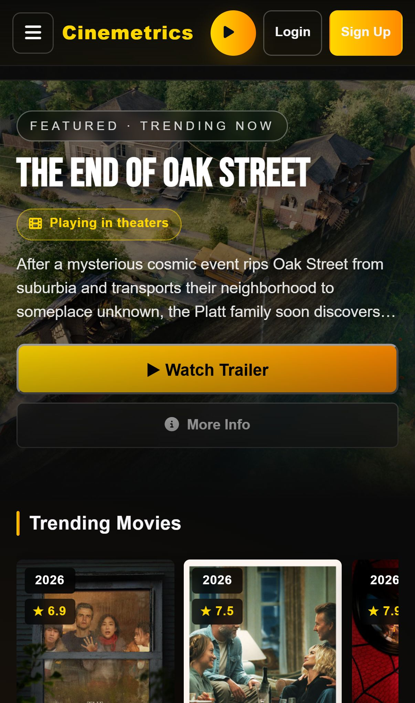
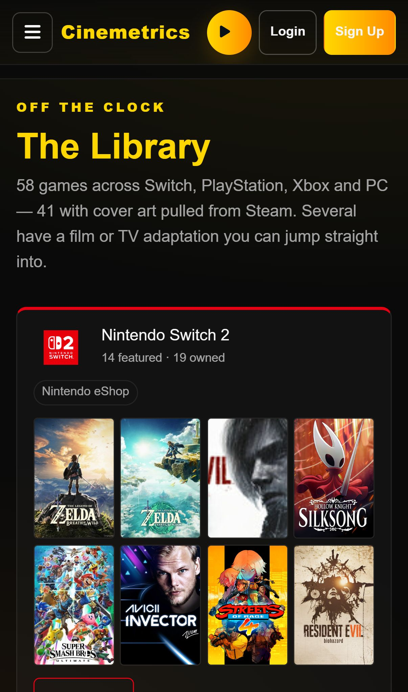

<div align="center">

# 🎬 Cinemetrics

**Browse what's trending, track what you've watched, and read Marvel characters argue about it — a movie/TV/games discovery app built from scratch with vanilla JavaScript.**

No React. No framework. Native ES modules, a hand-rolled component layer, and an Express API.

[](https://capstonesavvycoders.netlify.app/)
[](https://capstonesavvycoders.netlify.app/)
[](https://capstonesavvycoders.onrender.com/status)


<br />



</div>

---

## What it does

Cinemetrics pulls live data from **TMDB**, a dozen-plus news outlets per category, and **OpenStreetMap** into one place, then adds two things a plain TMDB client doesn't have: a personal record of what you've watched, and a cast of fictional Marvel characters with opinions about it.

**Discover**

|  | |
|---|---|
| 🎞️ **Movies** | Trending, popular and top-rated, with genre / year / rating / sort filters, plus a movie-news wire (12 RSS sources + The Guardian) right on the home page |
| 📺 **TV & Streaming** | Browse by service — Netflix, HBO Max, Prime, Disney+, Apple TV+, Hulu, Peacock — with its own news rail alongside |
| 🎟️ **In Theaters** | Enter a ZIP → what's playing + the closest cinemas within 25 miles |
| 🎮 **Games** | What's on the radar, a 16-feed gaming wire, and a personal library with cover art |
| 📍 **Where to watch** | A streaming-provider badge (or a theater icon) right on the poster, batched and cached so it doesn't cost a TMDB call per card |

**Track**

|  | |
|---|---|
| 🔖 **My List** | Watchlist saved to `localStorage`, no account required |
| ⭐ **Ratings & Watched** | A native 1-10 rating and "Mark Watched" per movie for signed-in users — Cinemetrics' own community score, kept visibly separate from TMDB's |

**Discuss**

|  | |
|---|---|
| 🦸 **Marvel** | A live countdown to *Avengers: Doomsday*, its 35-strong cast, and the full MCU by phase |
| 🎭 **Marvel Comments** | 72 fan-made Marvel character accounts post in-character, fact-grounded comments on real movies — each voice researched and kept distinct, not interchangeable one-liners |
| 🔥 **Hot Takes** | Two separate leaderboards: real human discussion, and the character threads — never blended, so one can't be mistaken for the other |

---

## News intelligence & editorial workflow *(internal, not a public feature)*

The movie/Marvel news wires above are public and visible to every visitor. Behind them, as of October 2026, Cinemetrics is also building internal infrastructure to research and queue entertainment news candidates — there is no public editorial UI, and nothing here posts anywhere.

- **Related-source grouping** — when multiple outlets independently cover the same story, the feed attaches them to each other (publisher, URL, published date, why they were matched) instead of showing a wall of near-duplicate cards.
- **First-seen tracking** — the moment Cinemetrics' own discovery pass first saw a given article is persisted (survives restarts), separately from the outlet's own publish date.
- **A private, authenticated editorial queue** — a researched story (sources + fact-checked claims + a draft) can be queued for review. Every submission requires an authenticated human to explicitly attest the draft's language matches what's actually been verified; an unreviewed or unverified draft is mechanically rejected, not just discouraged. Duplicate submissions are rejected at the database level, not just by convention.

**What this is NOT (yet):** there is no connection to Buffer, Threads, or any social platform anywhere in this codebase, no scheduling, and no autonomous/unattended posting of any kind. A queued item reaching "ready for review" never implies it's cleared to publish — publishing itself hasn't been built. See [`docs/architecture.md`](docs/architecture.md) for the verified current shape of this system and [`docs/decisions.md`](docs/decisions.md) for why it's built the way it is.

---

## Screenshots

<table>
<tr>
<td width="50%"><br /><sub><b>TV & Streaming</b> — browse by service, news rail alongside</sub></td>
<td width="50%"><br /><sub><b>In Theaters</b> — ZIP lookup, ticket links, nearest cinemas</sub></td>
</tr>
<tr>
<td width="50%"><br /><sub><b>The Library</b> — game collection with per-console rigs</sub></td>
<td width="50%"><br /><sub><b>Movie News</b> — magazine layout across 12 sources, now a section on the home page rather than its own route</sub></td>
</tr>
<tr>
<td colspan="2"><br /><sub><b>Detail modal</b> — certification, cast, crew, where to watch, and scored reviews</sub></td>
</tr>
</table>

<div align="center">


<br />
<sub>Verified on 11 devices — iPhone 15/16/17, Pixel 8/9/10, Galaxy S24, Z Flip 7, Z Fold 7</sub>
</div>

---

## Things I'm proud of

**⚡ 9.9 seconds → 5 milliseconds.** The curated pages each fanned out to dozens of TMDB calls on *every* request. A response-cache middleware that taps `res.json` — so no route handler changed — plus a boot-time warm-up:

| Route | Before | After |
|---|---|---|
| `/movies/marvel` | 9866 ms | **5 ms** |
| `/movies/upcoming-curated` | 2358 ms | **1 ms** |

**🖼️ No more blank screens.** The router used to `await` every fetch before rendering, so slow routes showed an empty white page. Now the chrome and a shimmer skeleton paint first, so navigation is never a blank page.

**🔍 Every news feed verified before shipping.** 30 candidate RSS feeds were tested against the live parser. The ones that 404'd, paywalled, timed out, or had gone stale are recorded in `REJECTED_FEEDS` with the reason, so nobody re-adds a dead source. A per-outlet cap keeps high-volume wires from crowding out slower ones.

**🎟️ Showtimes without a paid API.** No free showtimes API exists — Fandango has none, Gracenote wants a paid account. So Cinemetrics resolves the ZIP through Zippopotam, finds real cinemas via OpenStreetMap's Overpass API, and deep-links into Fandango/AMC/Regal/Cinemark with the movie and location pre-filled. On mobile those are universal links, so they open the chain's native app.

**🤖 An independent AI audit, acted on honestly.** Ran Gemini and ChatGPT against the live codebase (not a description of it) to find real gaps. One finding: "Hot Takes" — a leaderboard of the busiest comment threads — was ranking 109 fan-made Marvel character accounts against exactly 1 real human user, so "busiest conversations" was 100% synthetic activity presented as community buzz. Fixed by splitting it into separate, clearly-labeled "Community" and "Character Chaos" surfaces rather than hiding or deleting the bot content — it's fine as an explicit entertainment feature, it just can't pretend to be organic.

**🔀 Built with three AI sessions running in parallel.** Three Claude Code sessions worked this codebase simultaneously — one on content/bots, one on CSS/UI, one coordinating — with named lanes, explicit file ownership, and a shared living status doc instead of one thread doing everything in sequence. Full writeup in [`docs/ai-research-findings.md`](docs/ai-research-findings.md) and [`docs/project-status.md`](docs/project-status.md).

---

## Tech stack

**Frontend** — Vanilla JS (ES modules) · [Navigo](https://github.com/krasimir/navigo) routing · `html-literal` templating · Parcel · hand-written CSS (no framework)

**Backend** — Node + Express · Mongoose/MongoDB Atlas · JWT auth · `rss-parser` · in-memory TTL cache

**Data** — [TMDB](https://www.themoviedb.org/) · [The Guardian](https://open-platform.theguardian.com/) · 40+ curated RSS feeds across movies/TV/streaming/gaming · [Zippopotam](https://zippopotam.us/) · [OpenStreetMap Overpass](https://overpass-api.de/)

```
├── index.js          # router, state wiring, modals, event delegation
├── views/            # one module per page, returns an HTML string
├── store/            # per-view state objects
├── components/       # header, nav, main, footer
├── services/api.js   # every backend call in one place
├── docs/             # project status, architecture, decision log, AI research findings, bot-content handoff
├── AGENTS.md         # shared rules for any AI system working on this repo
├── CLAUDE.md         # Claude Code's own entry point — read this first in a new session
└── server/
    ├── app.js         # express app + middleware (no import-time side effects — see server.js)
    ├── server.js      # DB connect, listener, cache warm-up
    ├── models/        # user, comments, userMedia, movieResearchCache, editorialCandidate, newsFirstSeen
    ├── routes/        # movies, tv, news, person, comments, user-media, research-cache, editorial-queue, auth, users
    ├── services/      # editorial validation, news grouping/first-seen, news-to-queue bridge
    ├── config/        # publishingPolicy.js — the one place that decides who may ever publish (nobody can yet)
    ├── controllers/   # curated Marvel / upcoming data
    ├── scripts/       # seed data, idempotent bot-comment posting
    ├── research/      # fixture-driven research for news-grouping algorithm candidates
    └── utils/cache.js
```

---

## Run it locally

**Requires** Node 16+ and a [TMDB API key](https://www.themoviedb.org/settings/api) (free).

```bash
git clone https://github.com/jamesmnguyen704/CapstoneSavvyCoders.git
cd CapstoneSavvyCoders
npm install
```

Create `.env` in the project root:

```bash
TMDB_API_KEY=your_tmdb_key          # required
TMDB_ACCESS_TOKEN=your_tmdb_token   # required for some routes
MONGODB=your_mongodb_uri            # required for auth + comments
JWT_SECRET=dev_secret_change_me
BACKEND_PORT=3000
GUARDIAN_API_KEY=                   # optional, falls back to a rate-limited test key
RESEND_API_KEY=                     # optional, welcome emails
EMAIL_FROM=you@example.com
```

Two terminals:

```bash
npm run app:watch   # API on :3000 (nodemon)
npm start           # frontend on :1234
```

Open **http://localhost:1234**.

> ⚠️ Don't run `npm run build` while the dev server is running — they share
> `.parcel-cache`, and the dev server will silently serve a stale bundle.

| Script | Does |
|---|---|
| `npm start` / `npm run dev` | Parcel dev server on `:1234` |
| `npm run server` | API once (`node server/start.js`) |
| `npm run app:watch` | API with nodemon |
| `npm run build` | Production build to `dist/` |
| `npm run seed` | Seed test data |
| `npm run bot-comments -- path/to/batch.json` | Idempotent Marvel-comment bot posting |

**Tests** — no test framework dependency, uses Node's built-in runner:

```bash
DOTENV_PATH=/path/to/.env node --test --test-concurrency=1 server/*.test.js server/middleware/*.test.js server/routes/*.test.js server/services/*.test.js server/research/*.test.js
```

`--test-concurrency=1` is required — several test files share one isolated test database and race each other under the runner's default concurrent execution. `DOTENV_PATH` is only needed for the tests that touch MongoDB; pure-logic tests run without it.

---

## Working on this with an AI coding agent

This project is developed with Claude Code doing the engineering, plus a ChatGPT conversation for independent review and a parallel research-only lane for exploring future ideas — see [`AGENTS.md`](AGENTS.md) for how that's structured. If you're an AI session picking this repo up fresh: read [`CLAUDE.md`](CLAUDE.md) and [`AGENTS.md`](AGENTS.md) first, then [`docs/project-status.md`](docs/project-status.md) for current state — don't re-derive it from scratch.

---

## API

Base: `https://capstonesavvycoders.onrender.com`

| Endpoint | Returns |
|---|---|
| `GET /status` | Health + cache stats |
| `GET /movies/trending` · `/popular` · `/top_rated` · `/now_playing` | Movie lists |
| `GET /movies/discover` | Filter by genre, year, rating, sort |
| `GET /movies/:id/details` | Full detail — cast, crew, keywords, certification, reviews, providers |
| `GET /movies/marvel` · `/doomsday` · `/upcoming-curated` | Curated, cached |
| `GET /movies/in-theaters?zip=` | Now playing + ticket links |
| `GET /movies/theaters-near?zip=` | Cinemas within 25 miles |
| `GET /tv` · `/tv/providers?provider=` · `/tv/:id/details` | TV shows |
| `POST /tv/meta/availability` · `/movies/meta/availability` | Batched, 24h-cached "where to watch" lookup for a whole grid |
| `GET /news` · `/news/marvel` · `/news/tv` · `/news/streaming` · `/news/gaming` | Aggregated wires |
| `GET /comments/:movieId` · `POST /comments` · `/comments/:id/vote` | Comments + thumbs up/down |
| `GET /comments/meta/top?audience=` | Hot Takes — `human` (real visitors) or `character` (the Marvel bots), never blended |
| `POST /comments/meta/counts` | Batched comment-count lookup for a grid |
| `GET/POST /user-media/:movieId` · `GET /user-media/meta/rating/:movieId` | Personal rating/watched state, and the aggregate community score |
| `POST /auth/signup` · `/auth/login` | JWT auth |
| `POST/GET /editorial-queue` | **Internal only**, authenticated + account-gated — the private news-editorial workflow described above. Not a public feature. |

---

## Deployment

Frontend on **Netlify**, API on **Render**, both from `master`.

`VITE_BACKEND_URL` must be set in Netlify's environment — Parcel inlines it at
**build time**, so a build without it bakes in `localhost:3000` and every page
comes up empty. (The name is misleading — nothing in this app uses Vite, Parcel
is the only bundler — but it's the actual variable name the build reads.)

---

<details>
<summary><b>📚 Build log — week by week</b></summary>

<br />

- **Week 1 — Scaffold.** Parcel + native ES modules, `index.html`, entry `index.js`, basic nav. Initial routing and skeleton pages.
- **Week 2 — Backend & database.** Mongoose schema design, `server/app.js`, `server/models/user.js`, MongoDB connection. User schema with bcrypt hashing and an auth controller prototype.
- **Week 3 — TMDB integration.** API basics and image paths; poster fetching and movie-list rendering in `services/api.js`.
- **Week 4 — Layout & styling.** CSS Grid/Flex quirks and responsive technique; fixed poster sizing, added defensive grid rules, `.marvel-overview` wrapping.
- **Week 5 — Auth UI + router.** Client-side form handling and state flow; exported login/signup views, attached handlers, saved token to `localStorage`.
- **Week 6 — Dev ergonomics.** Port management and env vars; added `BACKEND_PORT` so Parcel (`1234`) and the API (`3000`) stop competing.
- **Week 7 — Polish & docs.** This README, plus CSS and auth fixes.
- **Week 8 — Performance & scale.** Response caching, route skeletons, expanded news aggregation, and three new sections (TV, In Theaters, Games).
- **Week 9 — Security, the Marvel comment system, and an AI research audit.** A full security pass (rate limiting, input validation, XSS fixes, ten PRs in one morning); a fan-made Marvel character comment system (72 accounts after a roster trim from 108, each grounded in real reviews or confirmed plot facts, with a voice/personality reference so they don't read generic); native 1-10 ratings and a "Watched" toggle; and an independent Gemini + ChatGPT research pass against the live codebase that caught a real integrity problem (Hot Takes ranking synthetic bot activity as community buzz) and a real SEO defect (every URL, even broken ones, returned HTTP 200) — both fixed the same day. Built across three Claude Code sessions running in parallel.

</details>

<details>
<summary><b>🔧 Troubleshooting & lessons learned</b></summary>

<br />

**Problems hit along the way**

- **Layout breaks** — cards rendered horizontally and the nav stacked vertically from malformed, cascading CSS.
- **Malformed CSS** — missing braces and a stray `white-space: nowrap` stopped descriptions wrapping.
- **Port conflicts** — `PORT` collisions made frontend and backend compete for `3000`.
- **Route NotFound** — `login`/`signup` weren't exported from `views/index.js`, so the router fell through.
- **Case-sensitive login** — emails were stored lowercased but looked up case-sensitively, so valid logins returned "User not found".
- **CSS specificity beating JavaScript** — `display: block !important` on the intro `<video>` out-specified `.hidden`, leaving an empty player painted over every trailer. The JS was correct the whole time.
- **Silent cache corruption** — running a production build while the dev server ran served a stale bundle with no error, which looked exactly like a real bug.

**Lessons**

- **Make the happy path explicit.** Name ports and env vars so tools can't steal each other's.
- **Normalize data early.** Store and compare canonical forms to avoid case-sensitivity bugs.
- **Specificity is a real bug class.** When behaviour contradicts the code, check computed styles before rewriting logic.
- **Measure before optimizing.** "Marvel feels slow" became actionable only once it was 9866 ms on the clock.
- **Verify external dependencies before shipping them.** Half the RSS feeds people recommend are dead.
- **Iterate in small commits** so experiments can be reverted cleanly.

**Handy commands**

```bash
npx kill-port 3000 1234                  # free stuck ports
netstat -ano | findstr ":3000"           # find the process (Windows)
curl -i http://localhost:3000/status     # API health
```

</details>

---

## Roadmap

- [x] ~~Personal ratings and reviews — a real "Cinemetrics Score"~~ — shipped, kept separate from TMDB's own score
- [x] ~~Browse-by-provider for movies, not just TV~~ — shipped for both, batched and cached
- [ ] TV show detail modal (`/tv/:id/details` is built and waiting on a UI)
- [ ] Metascore + Rotten Tomatoes scores via OMDb
- [ ] Real person/cast pages (TMDB's `combined_credits`) — clicking an actor currently dead-ends
- [ ] Franchise/collection pages for non-Marvel series (TMDB already has this data)
- [ ] "On my services" personalized filtering, now that watch-provider data exists
- [ ] Live Steam playtime on the Games page

**Further out — concepts, not committed work:** actor filmography pages, franchise hubs beyond Marvel, deeper TV/anime/gaming coverage, and broader "entertainment intelligence" across categories. The internal news-editorial workflow above is a step toward one of these ideas (surfacing what's actually trending across sources), not a finished product — connecting it to any publishing destination is unbuilt and unscheduled.

Full, current backlog (including findings from an external AI research pass) lives in [`docs/project-status.md`](docs/project-status.md) and [`docs/ai-research-findings.md`](docs/ai-research-findings.md).

---

<div align="center">

**Built by [James Nguyen](https://github.com/jamesmnguyen704)** · Savvy Coders capstone

<sub>Movie data courtesy of <a href="https://www.themoviedb.org/">TMDB</a>. This product uses the TMDB API but is not endorsed or certified by TMDB.</sub>

</div>
